# Analisis de algoritmos en el contexto de la bibliometria

**Proyecto final - Analisis de Algoritmos - Universidad del Quindio, Programa de Ingenieria de Sistemas y Computacion, 2026-2**

**Integrantes:** Cristhian Camilo Lopez Grajales, Mariana Pineda Montenegro y Camila Hernandez Pena

**Dominio:** inteligencia artificial generativa y IA en educacion - **Corpus:** 20 articulos cientificos (solo se procesa el abstract)

**Aplicacion desplegada:** `ENLACE_PUBLICO_DE_RENDER` *(reemplazar por la URL real al desplegar; ver README)*

> Todos los numeros, tablas y figuras de este documento se generaron ejecutando el codigo del repositorio (`scripts/generar_evidencias.py`). Ningun resultado se escribio a mano. Tiempos medidos en: Python 3.12.3, Linux-6.18.44-fc-v185-x86_64-with-glibc2.39, 1 CPU(s).

---

## 1. Introduccion

El analisis computacional de textos cientificos permite describir y comparar publicaciones con metodos cuantitativos. Este proyecto enfrenta el reto de procesar lenguaje natural no estructurado pasando de algoritmos y estructuras de datos clasicos a representaciones modernas basadas en IA. Sobre un corpus controlado de 20 articulos en PDF se implementaron, **desde cero**, tres familias de algoritmos: (1) similitud textual (cuatro clasicos y dos con embeddings), (2) clustering jerarquico con tres criterios de enlace y (3) busqueda exacta de patrones (KMP, Boyer-Moore y Rabin-Karp). Para cada una se presenta un caso de estudio con calculo paso a paso, un analisis critico y una contrastacion entre la complejidad teorica y los tiempos reales medidos. La aplicacion web esta construida con Flask y se despliega en Render.

**Restricciones respetadas.** Los algoritmos usan solo listas, bucles y estructuras propias (`src/estructuras_datos.py`). No se usan scipy, sklearn, numpy, pandas, difflib, `find()`, `index()`, `in` ni expresiones regulares en la logica de los algoritmos. Las librerias externas solo apoyan: `pypdf` (leer PDFs, script offline), modelos preentrenados (embeddings, script offline), `matplotlib` (graficas) y `Flask`/`gunicorn` (web).

## 2. Arquitectura y diseno

### 2.1 Diagrama de componentes

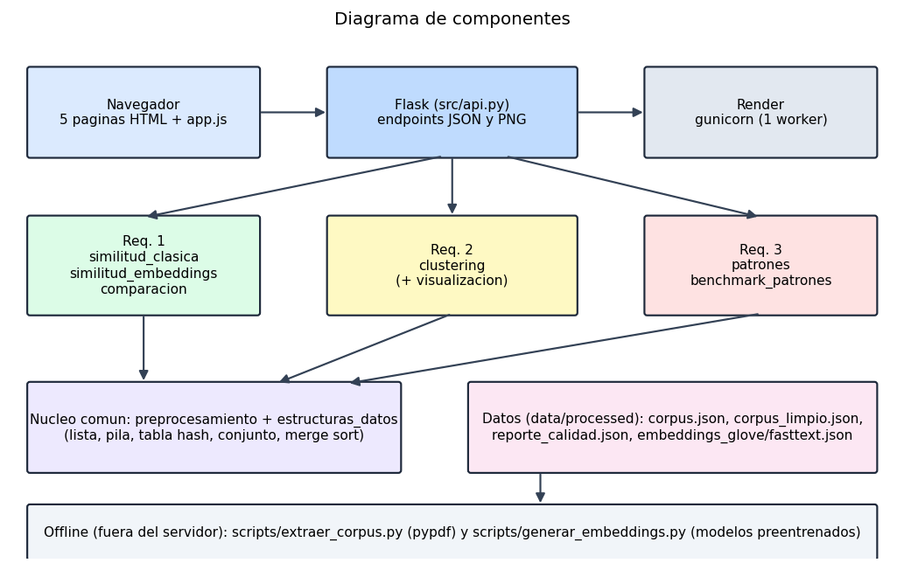

### 2.2 Flujo de datos

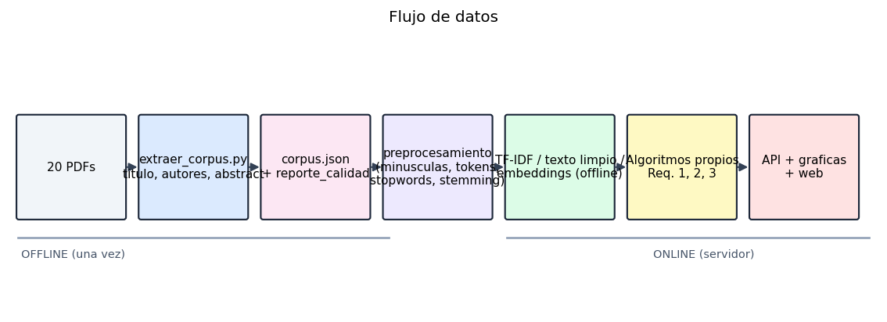

**Idea central:** todo lo costoso o dependiente de librerias pesadas ocurre **fuera del servidor** (extraccion de PDFs y embeddings) y deja archivos JSON en `data/processed/`. El servidor solo lee esos JSON, ejecuta los algoritmos propios y dibuja. Asi la app cabe en el plan gratuito de Render.

| Capa | Archivos | Responsabilidad |
|-------------------|----------------------------------------------------------------------|----------------------------------------------------------------------|
| Datos offline | `scripts/extraer_corpus.py`, `scripts/generar_embeddings.py` | PDF -> `corpus.json`, `reporte_calidad.json`, `embeddings_<modelo>.json` |
| Estructuras propias | `src/estructuras_datos.py` | Lista dinamica, pila, tabla hash, conjuntos, matrices, ordenamiento por mezcla, minimo/maximo |
| Preprocesamiento | `src/preprocesamiento.py` | Minusculas, tildes, signos, tokenizacion, stopwords (EN/ES), stemming simple |
| Req. 1 | `src/similitud_clasica.py`, `src/similitud_embeddings.py`, `src/comparacion.py` | Levenshtein, Needleman-Wunsch, TF-IDF+coseno, Jaccard, coseno/euclidiana sobre embeddings |
| Req. 2 | `src/clustering.py` | Single/Complete/Average, historial de fusiones, correlacion cofenetica, silueta |
| Req. 3 | `src/patrones.py`, `src/benchmark_patrones.py` | KMP, Boyer-Moore, Rabin-Karp y mediciones de tiempo |
| Presentacion | `src/visualizacion.py`, `src/api.py`, `static/` | Graficas PNG, endpoints, 5 paginas web |
| Configuracion | `src/paths.py`, `Procfile`, `render.yaml` | Rutas por variables de entorno (con carpeta temporal de respaldo) y despliegue |


### 2.3 Decisiones de diseno

| Decision | Alternativa descartada | Motivo |
|----------------------------------------------------------------------|-------------------------------|----------------------------------------------------------------------|
| Embeddings calculados una sola vez, fuera del servidor | Cargar el modelo en la app | Los modelos pesan cientos de MB o GB; no caben en el plan gratuito de Render |
| Dos modelos de embeddings distintos: GloVe y fastText (300 d) | Un solo modelo | El enunciado exige dos; son algoritmos de entrenamiento distintos (co-ocurrencia global vs skip-gram con subpalabras) |
| Levenshtein y Needleman-Wunsch sobre caracteres del texto limpio | Nivel de palabra | Cumple la forma clasica de programacion dinamica; ~0,18 s por par es viable en la web |
| IDF suavizado ln((1+N)/(1+df))+1 con N = 20 abstracts | IDF = ln(N/df) | Evita IDF = 0 para terminos presentes en todos los documentos |
| Distancia de clustering = 1 - coseno TF-IDF | Distancia euclidiana | El coseno ignora la longitud de cada abstract |
| Criterios: Single, Complete y Average (UPGMA) | Ward | El enunciado pide tres y Ward requiere distancias euclidianas |
| Metrica interna principal: correlacion cofenetica; apoyo: silueta | Solo silueta | La silueta es baja y casi plana en este corpus; la cofenetica mide fidelidad del arbol |
| Clustering O(n^3) directo desde la matriz original | Actualizacion de Lance-Williams | Con n = 20 es instantaneo y la definicion de cada criterio queda visible en el codigo |
| Busqueda de patrones sobre el abstract original, sin distinguir mayusculas por defecto | Buscar en texto preprocesado | Las posiciones y el resaltado deben corresponder al texto real; la conversion a minusculas conserva la longitud |
| Rabin-Karp con base 256 y modulo primo 1.000.000.007 | Modulo pequeno | Colisiones casi nulas; el modulo pequeno se usa solo para demostrar colisiones |
| Un solo worker de gunicorn y cache en memoria | Varios workers | Plan gratuito de Render con poca memoria; los calculos son deterministas |


## 3. Corpus y preprocesamiento

### 3.1 Extraccion

`scripts/extraer_corpus.py` lee las dos primeras paginas de cada PDF con `pypdf`, normaliza ligaduras tipograficas (por ejemplo "fi"), localiza el abstract entre su encabezado (`ABSTRACT`, `Abstract`, `A B S T R A C T`) y la siguiente marca (`Keywords`, `1. Introduction`...), une las palabras cortadas por guion de fin de linea **solo si la palabra unida existe en el vocabulario del corpus**, y guarda `corpus.json`. Los titulos y autores se verificaron manualmente contra la pagina 1 (los metadatos internos de los PDF son incompletos) y el script comprueba que cada titulo aparezca textual en la pagina.

Casos especiales documentados: el articulo #7 (dos columnas) usa un ancla de inicio manual, el #9 no tiene marca de fin y usa un ancla de fin manual, y el #14 trae en el PDF original una referencia bibliografica pegada dentro del abstract; se conserva el texto original en `abstract_original` y se elimina la cita en `abstract` (`correccion_manual`). Ademas se corrigieron dos artefactos de extraccion, tambien registrados en `correccion_manual`: en el #6 el PDF pierde el espacio antes de una ligadura (`researchfield` -> `research field`) y en el #17 un guion de salto de linea no resuelto (`holisti-cally` -> `holistically`).

### 3.2 Reporte de calidad

Resultado: **20 de 20 abstracts validados** (sin residuos de citas ni palabras clave, longitud entre 130 y 257 palabras, inicio en mayuscula y cierre con punto, titulo verificado y concordancia >= 0,9 con una extraccion Java independiente).

| ID | Autores | Palabras | Caracteres | Titulo |
|-----------:|-----------:|-----------:|-----------:|----------------------------------------------------------------------|
| 1 | 4 | 187 | 1147 | Artificial intelligence literacy in higher and adult education: A scoping literature review |
| 2 | 5 | 127 | 904 | Systematic literature review on opportunities, challenges, and future research recommendations of artificial intelligence in education |
| 3 | 4 | 233 | 1545 | Myths, mis- and preconceptions of artificial intelligence: A review of the literature |
| 4 | 5 | 207 | 1410 | Opportunities of artificial intelligence for supporting complex problem-solving: Findings from a scoping review |
| 5 | 4 | 244 | 1816 | Application and theory gaps during the rise of Artificial Intelligence in Education |
| 6 | 3 | 172 | 1190 | A multi-perspective study on Artificial Intelligence in Education: grants, conferences, journals, software tools, institutions, and researchers |
| 7 | 7 | 232 | 1603 | Human-centred learning analytics and AI in education: A systematic literature review |
| 8 | 3 | 209 | 1435 | A systematic review of artificial intelligence techniques for collaborative learning over the past two decades |
| 9 | 2 | 161 | 1245 | AI technologies for education: Recent research & future directions |
| 10 | 2 | 200 | 1441 | Educational applications of artificial intelligence in simulation-based learning: A systematic mapping review |
| 11 | 5 | 185 | 1379 | A scoping review on how generative artificial intelligence transforms assessment in higher education |
| 12 | 9 | 250 | 1793 | A meta systematic review of artificial intelligence in higher education: a call for increased ethics, collaboration, and rigour |
| 13 | 2 | 246 | 1668 | Artificial intelligence for education and its emphasis on assessment and adversity quotient: a review |
| 14 | 3 | 131 | 979 | A comprehensive exploration of artificial intelligence competence frameworks for educators: A critical review |
| 15 | 5 | 218 | 1476 | A Systematic Review of Generative AI for Teaching and Learning Practice |
| 16 | 2 | 153 | 1088 | Generative Artificial Intelligence in Tertiary Education: Assessment Redesign Principles and Considerations |
| 17 | 3 | 204 | 1506 | A Systematic Review of AI-Driven Educational Assessment in STEM Education |
| 18 | 4 | 206 | 1572 | Transforming Education: A Comprehensive Review of Generative Artificial Intelligence in Educational Settings through Bibliometric and Content Analysis |
| 19 | 1 | 210 | 1425 | What Is the Impact of ChatGPT on Education? A Rapid Review of the Literature |
| 20 | 4 | 207 | 1456 | Systematic review of research on artificial intelligence applications in higher education – where are the educators? |


### 3.3 Preprocesamiento escrito a mano

| Paso | Que hace | Por que |
|------------------|----------------------------------------------------------------------|--------------------------------------------------------|
| 1. Minusculas | A-Z y letras latinas acentuadas -> minuscula (conserva la longitud) | `Education` y `education` son el mismo termino |
| 2. Sin tildes | a, e, i, o, u, n con acento -> sin acento | Unifica variantes en espanol |
| 3. Sin signos | Todo lo que no sea letra a-z pasa a espacio (digitos, guiones, apostrofes) | `AI-driven` -> `ai`, `driven` |
| 4. Tokenizacion | Parte por espacios con un bucle | Unidad minima de analisis |
| 5. Stopwords | Descarta palabras vacias EN/ES y tokens de menos de 2 letras | `ai` (2 letras) se conserva porque es el tema del corpus |
| 6. Stemming simple | Reglas de sufijos (-ation, -ing, -ies, -ed, -es, -s...) | Reduce variantes (learning/learner/learn) |


**Ejemplo real (abstract #2).** Primeros tokens finales: `applicate artificial intelligence educate aied emerg new researcher practitioner alike review relevant literature examin ...`

**Efecto medido:** el corpus tiene 3982 tokens, 2431 tras quitar stopwords; el vocabulario baja de 973 a 833 terminos con stemming (14.4 % menos). Por eso se usa stemming en TF-IDF, Jaccard y clustering, mientras que Levenshtein/Needleman-Wunsch usan el texto limpio sin stemming y los embeddings usan tokens sin stemming (los modelos preentrenados contienen palabras completas).

El texto limpio de cada abstract se guarda en `data/processed/corpus_limpio.json`.

## 4. Requerimiento 1: similitud textual

### 4.1 Explicacion tecnica

| Algoritmo | Tipo | Entrada | Salida [0,1] | Tiempo | Espacio |
|----------------|---------------------------|---------------------------|--------------------------------------|---------------|------------------------------|
| Levenshtein | Clasico (prog. dinamica) | Texto limpio, caracteres | 1 - D/max(m,n) | O(m*n) | O(min(m,n)); O(m*n) con matriz |
| Needleman-Wunsch | Clasico (prog. dinamica) | Texto limpio, caracteres | Puntaje normalizado con cotas teoricas | O(m*n) | O(n); O(m*n) con traceback |
| Coseno TF-IDF | Clasico (espacio vectorial) | Tokens con stemming | Coseno (>= 0 en TF-IDF) | O(V) por par | O(V) por documento |
| Jaccard | Clasico (conjuntos) | Tokens con stemming | /A inter B/ / /A union B/ | O(m+n) promedio | O(m+n) |
| GloVe 300 d | IA (embeddings) | Vector promedio normalizado | Coseno recortado a [0,1] | O(d) | O(d) |
| fastText 300 d | IA (embeddings) | Vector promedio normalizado | Coseno recortado a [0,1] | O(d) | O(d) |


**Formulas.** Levenshtein: `D[i][j] = min(D[i-1][j]+1, D[i][j-1]+1, D[i-1][j-1]+costo)`. Needleman-Wunsch: `F[i][j] = max(F[i-1][j-1]+s, F[i-1][j]+gap, F[i][j-1]+gap)` con s = +1 (coincide), -1 (difiere) y gap = -1; normalizacion `(puntaje - minimo)/(maximo - minimo)` con `maximo = min(m,n) - |m-n|` y `minimo = -(m+n)`. TF = conteo/total de tokens; IDF = ln((1+N)/(1+df)) + 1; coseno = (u.v)/(|u||v|). Jaccard = |A inter B|/|A union B|. Euclidiana d = raiz(suma (ui - vi)^2), con similitud 1/(1+d).

**Embeddings (IA).** Se usaron dos modelos preentrenados de palabras, ambos de 300 dimensiones: `glove-wiki-gigaword-300` (GloVe (Stanford) entrenado con Wikipedia 2014 + Gigaword 5 (6B tokens), 300 dimensiones, 400k palabras.) y `fasttext-wiki-news-subwords-300` (fastText (Facebook) entrenado con Wikipedia 2017 + UMBC + statmt.org news (16B tokens), 300 dimensiones, 1M palabras.). El vector de un abstract es el **promedio** de los vectores de sus palabras (tokens en minuscula, sin stopwords y sin stemming), normalizado a norma 1. Se calcula una sola vez con `scripts/generar_embeddings.py` y se guarda en `data/processed/embeddings_<modelo>.json`; la web solo lee los vectores. El coseno y la distancia euclidiana se calculan con nuestras funciones. Son modelos de vectores de palabras agregados, **no** modelos de lenguaje tipo Transformer.

### 4.2 Caso de estudio

**Seleccion objetiva.** Se calcularon los 190 pares posibles entre los 20 abstracts. El par mas parecido segun el coseno TF-IDF es **#2 y #6** (caso de estudio) y el menos parecido es #14 y #19 (contraste).

**Abstract #2** - *Systematic literature review on opportunities, challenges, and future research recommendations of artificial intelligence in education*

> Applications of artificial intelligence in education (AIEd) are emerging and are new to researchers and practitioners alike. Reviews of the relevant literature have not examined how AI technologies have been integrated into each of the four key educational domains of learning, teaching, assessment, and administration. The relationships between the technologies and learning outcomes for students and teachers have also been neglected. This systematic review study aims to understand the opportunities and challenges of AIEd by examining the literature from the last 10 years (2012 – 2021) using matrix coding and content analysis approaches. The results present the current focus of AIEd research by identifying 13 roles of AI technologies in the key educational domains, 7 learning outcomes of AIEd, and 10 major challenges. The review also provides suggestions for future directions of AIEd research.

**Abstract #6** - *A multi-perspective study on Artificial Intelligence in Education: grants, conferences, journals, software tools, institutions, and researchers*

> With the rapid development of artificial intelligence (AI) technologies and a continuously growing interest in their application in educational contexts, there has been significant growth in the scientific literature in relation to the application of AI in education (AIEd). This study aims to present multiple perspectives on the development of AIEd in terms of relevant grants, conferences, journals, software tools, article trends, top issues, institutions, and researchers to provide an overview of AIEd for its further development and implementation. With this study, we contribute to the research field by enabling educators and scholars to understand the status and development of relevant grants and publications concerning AIEd. Also,findings concerning active actors can help educators and scholars identify the active researchers and institutions in the research on AIEd. Furthermore, researchers and educators are able to identify relevant journals and be more aware of major issues in AIEd studies. In addition, we also highlight the significance and necessity of the launch of the new Elsevier journal AIEd-related journal named Computers & Education: Artificial Intelligence.

#### 4.2.1 Levenshtein: llenado de la matriz

Matriz completa sobre los **primeros 10 caracteres** del texto limpio de cada abstract (`applicatio` y `rapid deve`). La fila 0 y la columna 0 son el costo de insertar/borrar todo; cada celda toma el minimo de borrar (arriba + 1), insertar (izquierda + 1) o sustituir (diagonal + costo, 0 si los caracteres son iguales).

| a \ b | - | r | a | p | i | d |   | d | e | v | e |
|------------|-----------:|-----------:|-----------:|-----------:|-----------:|-----------:|-----------:|-----------:|-----------:|-----------:|-----------:|
| - | 0 | 1 | 2 | 3 | 4 | 5 | 6 | 7 | 8 | 9 | 10 |
| a | 1 | 1 | 1 | 2 | 3 | 4 | 5 | 6 | 7 | 8 | 9 |
| p | 2 | 2 | 2 | 1 | 2 | 3 | 4 | 5 | 6 | 7 | 8 |
| p | 3 | 3 | 3 | 2 | 2 | 3 | 4 | 5 | 6 | 7 | 8 |
| l | 4 | 4 | 4 | 3 | 3 | 3 | 4 | 5 | 6 | 7 | 8 |
| i | 5 | 5 | 5 | 4 | 3 | 4 | 4 | 5 | 6 | 7 | 8 |
| c | 6 | 6 | 6 | 5 | 4 | 4 | 5 | 5 | 6 | 7 | 8 |
| a | 7 | 7 | 6 | 6 | 5 | 5 | 5 | 6 | 6 | 7 | 8 |
| t | 8 | 8 | 7 | 7 | 6 | 6 | 6 | 6 | 7 | 7 | 8 |
| i | 9 | 9 | 8 | 8 | 7 | 7 | 7 | 7 | 7 | 8 | 8 |
| o | 10 | 10 | 9 | 9 | 8 | 8 | 8 | 8 | 8 | 8 | 9 |


Distancia del fragmento = **9**. Sobre el texto limpio completo (652 y 903 caracteres, matriz de 653 x 904 celdas) la distancia es **608**, es decir similitud = 1 - 608/903 = **0.3267**.

#### 4.2.2 Needleman-Wunsch: matriz de puntajes y alineamiento

Mismos fragmentos, con coincidencia = +1, diferencia = -1 y hueco = -1. La fila 0 y la columna 0 valen `i * hueco`.

| a \ b | - | r | a | p | i | d |   | d | e | v | e |
|------------|-----------:|-----------:|-----------:|-----------:|-----------:|-----------:|-----------:|-----------:|-----------:|-----------:|-----------:|
| - | 0 | -1 | -2 | -3 | -4 | -5 | -6 | -7 | -8 | -9 | -10 |
| a | -1 | -1 | 0 | -1 | -2 | -3 | -4 | -5 | -6 | -7 | -8 |
| p | -2 | -2 | -1 | 1 | 0 | -1 | -2 | -3 | -4 | -5 | -6 |
| p | -3 | -3 | -2 | 0 | 0 | -1 | -2 | -3 | -4 | -5 | -6 |
| l | -4 | -4 | -3 | -1 | -1 | -1 | -2 | -3 | -4 | -5 | -6 |
| i | -5 | -5 | -4 | -2 | 0 | -1 | -2 | -3 | -4 | -5 | -6 |
| c | -6 | -6 | -5 | -3 | -1 | -1 | -2 | -3 | -4 | -5 | -6 |
| a | -7 | -7 | -5 | -4 | -2 | -2 | -2 | -3 | -4 | -5 | -6 |
| t | -8 | -8 | -6 | -5 | -3 | -3 | -3 | -3 | -4 | -5 | -6 |
| i | -9 | -9 | -7 | -6 | -4 | -4 | -4 | -4 | -4 | -5 | -6 |
| o | -10 | -10 | -8 | -7 | -5 | -5 | -5 | -5 | -5 | -5 | -6 |


Puntaje del fragmento = **-6** (esquina inferior derecha). Alineamiento optimo recuperado con *traceback* (`-` = hueco):

```text
-appli-catio
ra-p-id deve
```

Sobre el texto completo: puntaje = **-268**, maximo teorico = 401, minimo teorico = -1555, similitud normalizada = (-268 - (-1555)) / (401 - (-1555)) = **0.6580**.

#### 4.2.3 Coseno con TF-IDF: vocabulario, TF, IDF, pesos, producto punto, normas y angulo

**Vocabulario.** Los 20 abstracts forman un vocabulario de 833 terminos (con stemming). Estos dos abstracts usan 104 terminos distintos en total (union): |A| = 54 terminos en #2 y |B| = 68 en #6.

**IDF (calculado sobre los 20 abstracts, N = 20).** Ejemplos reales:

| Termino | df | IDF = ln(21/(1+df)) + 1 |
|------------|-----------:|----------------------:|
| aied | 7 | 1.9651 |
| educate | 18 | 1.1001 |
| ai | 18 | 1.1001 |
| researcher | 5 | 2.2528 |


Un termino raro (df bajo) pesa mas que uno que aparece en casi todos los abstracts.

**TF y pesos.** TF = conteo/total de tokens del abstract; peso = TF x IDF. Los 15 terminos con mayor aporte al producto punto (la tabla completa de 104 terminos esta en el Anexo A):

| Termino | df | IDF | TF #2 | TF #6 | w #2 | w #6 | w x w |
|------------|-----------:|-----------:|-----------:|-----------:|-----------:|-----------:|-----------:|
| aied | 7 | 1.965 | 0.0676 | 0.0686 | 0.1328 | 0.1349 | 0.01791 |
| researcher | 5 | 2.253 | 0.0135 | 0.0294 | 0.0304 | 0.0663 | 0.00202 |
| relevant | 7 | 1.965 | 0.0135 | 0.0294 | 0.0266 | 0.0578 | 0.00153 |
| educate | 18 | 1.100 | 0.0405 | 0.0294 | 0.0446 | 0.0324 | 0.00144 |
| major | 2 | 2.946 | 0.0135 | 0.0098 | 0.0398 | 0.0289 | 0.00115 |
| new | 3 | 2.658 | 0.0135 | 0.0098 | 0.0359 | 0.0261 | 0.00094 |
| technology | 12 | 1.480 | 0.0405 | 0.0098 | 0.0600 | 0.0145 | 0.00087 |
| aim | 4 | 2.435 | 0.0135 | 0.0098 | 0.0329 | 0.0239 | 0.00079 |
| research | 16 | 1.211 | 0.0270 | 0.0196 | 0.0327 | 0.0238 | 0.00078 |
| identify | 10 | 1.647 | 0.0135 | 0.0196 | 0.0223 | 0.0323 | 0.00072 |
| study | 14 | 1.336 | 0.0135 | 0.0294 | 0.0181 | 0.0393 | 0.00071 |
| applicate | 11 | 1.560 | 0.0135 | 0.0196 | 0.0211 | 0.0306 | 0.00064 |
| literature | 11 | 1.560 | 0.0270 | 0.0098 | 0.0422 | 0.0153 | 0.00064 |
| ai | 18 | 1.100 | 0.0270 | 0.0196 | 0.0297 | 0.0216 | 0.00064 |
| present | 6 | 2.099 | 0.0135 | 0.0098 | 0.0284 | 0.0206 | 0.00058 |


**Producto punto** = suma de w_A x w_B = **0.032251**.  **Normas:** |A| = raiz(suma w_A^2) = **0.306488**, |B| = **0.320173**.

**Coseno** = 0.032251 / (0.306488 x 0.320173) = **0.328661**.  **Angulo** = arccos(coseno) = **70.81 grados**.

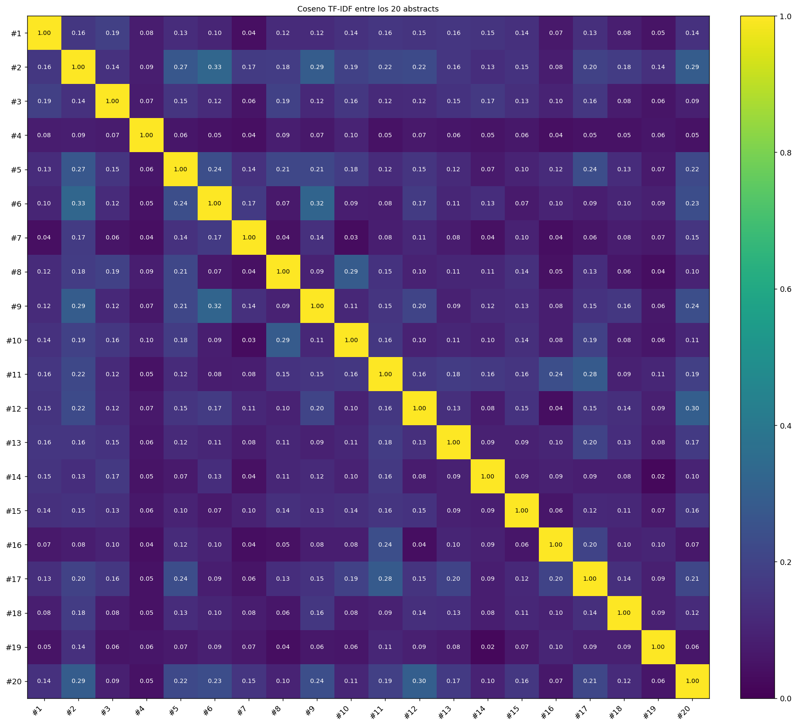

#### 4.2.4 Jaccard: interseccion y union

|A| = 54, |B| = 68, **|A inter B| = 18**, **|A union B| = 104** -> J = 18/104 = **0.1731**.

Terminos compartidos (con stemming): `ai`, `aied`, `aim`, `applicate`, `artificial`, `educate`, `identify`, `intelligence`, `literature`, `major`, `new`, `present`, `relevant`, `research`, `researcher`, `study`, `technology`, `understand`.

#### 4.2.5 Embeddings: como se obtiene el vector y su similitud

Pasos: (1) tokens del abstract sin stopwords y sin stemming; (2) se busca el vector de 300 dimensiones de cada palabra en el modelo; (3) se promedian los vectores encontrados; (4) se normaliza a norma 1; (5) se calcula coseno y distancia euclidiana entre los dos vectores.

| Modelo | Dim | Palabras con vector #2 | Palabras con vector #6 | Primeras 6 dim. #2 | Primeras 6 dim. #6 | Coseno | Dist. euclidiana | 1/(1+d) |
|-------------------------------|------------|----------------------|----------------------|---------------------------------------------------|----------------------------------------------------|------------|----------------|------------|
| glove-wiki-gigaword-300 | 300 | 69 de 74 (0.932) | 95 de 102 (0.931) | [-0.061, -0.004, 0.027, -0.053, 0.003, -0.011, ...] | [-0.049, -0.005, 0.008, -0.033, 0.002, 0.004, ...] | 0.9509 | 0.3135 | 0.7613 |
| fasttext-wiki-news-subwords-300 | 300 | 69 de 74 (0.932) | 95 de 102 (0.931) | [0.007, -0.075, 0.000, 0.016, -0.032, -0.034, ...] | [-0.000, -0.078, 0.022, -0.007, -0.048, -0.033, ...] | 0.9737 | 0.2296 | 0.8133 |


Como los vectores tienen norma 1, la distancia euclidiana cumple d^2 = 2 - 2 x coseno, por lo que ambas medidas ordenan los pares igual.

### 4.3 Analisis critico: clasicos frente a IA

**Resultados del caso de estudio y del contraste** (similitud normalizada [0,1]):

| Algoritmo | Tipo | Caso #2-#6 (mas parecidos) | Contraste #14-#19 (menos parecidos) | Posicion del caso entre 190 pares |
|-----------------|------------|-------------------------:|----------------------------------:|---------------------------------|
| Levenshtein | Clasico | 0.3267 | 0.2822 | 3 de 190 |
| Needleman-Wunsch | Clasico | 0.6580 | 0.5997 | 31 de 190 |
| Coseno TF-IDF | Clasico | 0.3287 | 0.0215 | 1 de 190 |
| Jaccard | Clasico | 0.1731 | 0.0510 | 7 de 190 |
| GloVe (coseno) | IA | 0.9509 | 0.8786 | 18 de 190 |
| fastText (coseno) | IA | 0.9737 | 0.9162 | 16 de 190 |


**Comportamiento sobre los 190 pares** (minimo, maximo, promedio y rango de los puntajes):

| Algoritmo | Minimo | Maximo | Promedio | Rango | Tiempo medio por par (ms) |
|-----------------|-----------:|-----------:|-----------:|-----------:|------------------------:|
| Levenshtein | 0.2260 | 0.3318 | 0.2824 | 0.1058 | 184.659 |
| Needleman-Wunsch | 0.5386 | 0.7638 | 0.6098 | 0.2252 | 187.173 |
| Coseno TF-IDF | 0.0215 | 0.3287 | 0.1241 | 0.3072 | 0.167 |
| Jaccard | 0.0267 | 0.1923 | 0.1060 | 0.1656 | 1.541 |
| GloVe (coseno) | 0.8383 | 0.9636 | 0.9137 | 0.1254 | 0.146 |
| fastText (coseno) | 0.9103 | 0.9827 | 0.9536 | 0.0724 | 0.144 |


**Correlacion de Spearman entre algoritmos** (acuerdo en el *orden* de los 190 pares; 1 = mismo orden):

|  | Levenshtein | Needleman-Wunsch | Coseno TF-IDF | Jaccard | GloVe (coseno) | fastText (coseno) |
|-----------------|-----------:|---------------:|------------:|-----------:|-------------:|----------------:|
| Levenshtein | 1.00 | 0.89 | 0.32 | 0.18 | 0.23 | 0.16 |
| Needleman-Wunsch | 0.89 | 1.00 | 0.25 | 0.10 | 0.16 | 0.06 |
| Coseno TF-IDF | 0.32 | 0.25 | 1.00 | 0.57 | 0.64 | 0.54 |
| Jaccard | 0.18 | 0.10 | 0.57 | 1.00 | 0.45 | 0.29 |
| GloVe (coseno) | 0.23 | 0.16 | 0.64 | 0.45 | 1.00 | 0.69 |
| fastText (coseno) | 0.16 | 0.06 | 0.54 | 0.29 | 0.69 | 1.00 |


**Interpretacion (basada en las tablas anteriores).**

1. **Cada familia mide algo distinto.** Levenshtein y Needleman-Wunsch comparan la *secuencia de caracteres*: su acuerdo mutuo es alto (Spearman 0.89) pero con TF-IDF es bajo (0.32 y 0.25). TF-IDF y Jaccard comparan *vocabulario compartido* (acuerdo 0.57). Los embeddings comparan *cercania semantica aproximada*; su acuerdo con TF-IDF es moderado (GloVe 0.64, fastText 0.54).

2. **Levenshtein y Needleman-Wunsch discriminan poco y dependen de la longitud.** Todos los pares caen en rangos estrechos (Levenshtein 0.226 a 0.332; Needleman-Wunsch 0.539 a 0.764). Se midio la relacion entre cada puntaje y la razon de longitudes de los textos limpios (min/max): la correlacion de Spearman es **-0.80** para Levenshtein y **-0.97** para Needleman-Wunsch, frente a **-0.14** para TF-IDF. Es decir, estos dos algoritmos ordenan los pares en buena medida segun cuanto difieren en longitud, no segun el tema. El signo negativo (a mayor diferencia de longitud, mayor similitud normalizada) es consistente con un artefacto de la normalizacion; no se investigo su mecanismo exacto. En el caso de estudio los textos miden 652 y 903 caracteres. Son medidas de *forma*, no de *significado*.

3. **TF-IDF y Jaccard separan mejor** (TF-IDF: 0.022 a 0.329). El caso de estudio sale 1.o en TF-IDF por construccion y 7.o en Jaccard: ponderar por IDF hace que terminos poco comunes como `aied` (df = 7) pesen mas que `educate` (df = 18). Limitacion: no ven sinonimos; "learner" y "student" son terminos distintos.

4. **Los embeddings dan valores altos para casi todos los pares** (GloVe 0.838 a 0.964; fastText 0.910 a 0.983). Diagnostico medido: el coseno de cada abstract con el vector medio de los 20 abstracts es de 0.958 en promedio (GloVe, minimo 0.917) y 0.978 (fastText, minimo 0.966); es decir, todos los vectores comparten una direccion dominante, como era de esperar al promediar palabras de un mismo dominio. Si se resta esa media (diagnostico, no usado por la app), los cosenos entre pares pasan a abarcar de -0.48 a 0.45 (GloVe) y de -0.57 a 0.62 (fastText): el orden fino entre documentos existe, pero el valor crudo lo oculta. Por eso el par mas parecido por TF-IDF ocupa solo el puesto 18 (GloVe) y 16 (fastText) en su ranking y el par de contraste conserva 0.879 y 0.916: **el valor absoluto no es comparable entre algoritmos; solo tiene sentido comparar el orden de los pares**.

5. **Costo.** Levenshtein y Needleman-Wunsch cuestan ~185 ms por par (O(m*n)); TF-IDF, Jaccard y embeddings cuestan entre 0.15 y 1.54 ms. Los embeddings son baratos al consultar, pero su costo real esta en el calculo previo del vector (modelos de cientos de MB), que se hizo offline.

6. **Conclusion.** Para *recuperar documentos que comparten terminologia* conviene TF-IDF; para *detectar cercania tematica general* los embeddings aportan una vision complementaria; para este corpus de abstracts, las medidas de edicion no son adecuadas como medida de similitud tematica, aunque son el ejemplo clasico de programacion dinamica. Los modelos de oraciones tipo Transformer (script opcional `generar_embeddings.py sbert`) podrian dar otro comportamiento, pero no se ejecutaron en este trabajo y por tanto no se reportan resultados ni se afirma que mejoren.

## 5. Requerimiento 2: clustering jerarquico

### 5.1 Explicacion tecnica

**Flujo:** abstracts -> preprocesamiento (con stemming) -> vectores TF-IDF -> matriz de distancias 20 x 20 (`1 - coseno`) -> fusiones sucesivas guardando el historial -> dendrograma dibujado con matplotlib a partir de ese historial (sin scipy).

**Algoritmo aglomerativo (`src/clustering.py::agrupar`):** empieza con 20 clusters de un documento; en cada paso fusiona el par de clusters mas cercano segun el criterio, registra `(a, b, distancia, tamano)` y repite hasta quedar uno solo (19 fusiones). Desempate determinista: menor distancia y luego menores identificadores.

| Criterio | Distancia entre clusters A y B | Tendencia |
|-----------------------|------------------------------|---------------------------------------------------------------------|
| Single Linkage | min d(a,b) | Encadenamiento: une grupos por un solo par cercano; arboles alargados |
| Complete Linkage | max d(a,b) | Grupos compactos de diametro parecido |
| Average Linkage (UPGMA) | promedio de todas las d(a,b) | Compromiso entre ambos |


**Complejidad:** tiempo O(n^3) y espacio O(n^2) en esta implementacion directa (n = 20 documentos; instantaneo).

**Metricas internas, implementadas a mano:** (1) *correlacion cofenetica*: Pearson entre las n(n-1)/2 distancias originales y las distancias cofeneticas (altura a la que dos documentos quedan por primera vez juntos); mas cerca de 1 = el arbol conserva mejor las distancias. (2) *silueta*: s(i) = (b - a)/max(a, b), con a = distancia media intra-grupo y b = menor distancia media a otro grupo, para un corte en k grupos.

**Verificacion contra scipy (solo en pruebas y en `generar_evidencias.py`, nunca en la app):** diferencia maxima de alturas de fusion = 0.0e+00 (single), 0.0e+00 (complete), 3.3e-16 (average); diferencia de correlacion cofenetica <= 4.4e-16. Los resultados propios coinciden con los de scipy.

### 5.2 Matriz de distancias y pasos de fusion

La matriz completa 20 x 20 esta en el Anexo B. Historial de fusiones de cada criterio (cluster `Cn` = n-esima fusion + 19; `#k` = articulo k):

**Single Linkage (enlace simple)** - alturas entre 0.671 y 0.901

| Paso | Une | con | Distancia | Tamano | Nuevo cluster |
|-----------:|------------|------------|-----------:|-----------:|-------------|
| 1 | #2 | #6 | 0.6713 | 2 | C20 |
| 2 | #9 | C20 | 0.6775 | 3 | C21 |
| 3 | #12 | #20 | 0.7017 | 2 | C22 |
| 4 | C21 | C22 | 0.7094 | 5 | C23 |
| 5 | #8 | #10 | 0.7117 | 2 | C24 |
| 6 | #11 | #17 | 0.7163 | 2 | C25 |
| 7 | #5 | C23 | 0.7269 | 6 | C26 |
| 8 | #16 | C25 | 0.7615 | 3 | C27 |
| 9 | C26 | C27 | 0.7646 | 9 | C28 |
| 10 | C24 | C28 | 0.7890 | 11 | C29 |
| 11 | #13 | C29 | 0.7988 | 12 | C30 |
| 12 | #3 | C30 | 0.8073 | 13 | C31 |
| 13 | #1 | C31 | 0.8120 | 14 | C32 |
| 14 | #18 | C32 | 0.8226 | 15 | C33 |
| 15 | #7 | C33 | 0.8260 | 16 | C34 |
| 16 | #14 | C34 | 0.8332 | 17 | C35 |
| 17 | #15 | C35 | 0.8387 | 18 | C36 |
| 18 | #19 | C36 | 0.8602 | 19 | C37 |
| 19 | #4 | C37 | 0.9005 | 20 | C38 |


**Complete Linkage (enlace completo)** - alturas entre 0.671 y 0.978

| Paso | Une | con | Distancia | Tamano | Nuevo cluster |
|-----------:|------------|------------|-----------:|-----------:|-------------|
| 1 | #2 | #6 | 0.6713 | 2 | C20 |
| 2 | #12 | #20 | 0.7017 | 2 | C21 |
| 3 | #9 | C20 | 0.7088 | 3 | C22 |
| 4 | #8 | #10 | 0.7117 | 2 | C23 |
| 5 | #11 | #17 | 0.7163 | 2 | C24 |
| 6 | #5 | C22 | 0.7860 | 4 | C25 |
| 7 | #16 | C24 | 0.8002 | 3 | C26 |
| 8 | #1 | #3 | 0.8120 | 2 | C27 |
| 9 | C21 | C25 | 0.8456 | 6 | C28 |
| 10 | #14 | C27 | 0.8484 | 3 | C29 |
| 11 | #15 | C23 | 0.8638 | 3 | C30 |
| 12 | #13 | #18 | 0.8681 | 2 | C31 |
| 13 | #7 | C28 | 0.8899 | 7 | C32 |
| 14 | C26 | C31 | 0.9101 | 5 | C33 |
| 15 | C29 | C30 | 0.9143 | 6 | C34 |
| 16 | #19 | C33 | 0.9223 | 6 | C35 |
| 17 | #4 | C34 | 0.9470 | 7 | C36 |
| 18 | C32 | C35 | 0.9638 | 13 | C37 |
| 19 | C36 | C37 | 0.9785 | 20 | C38 |


**Average Linkage (UPGMA)** - alturas entre 0.671 y 0.938

| Paso | Une | con | Distancia | Tamano | Nuevo cluster |
|-----------:|------------|------------|-----------:|-----------:|-------------|
| 1 | #2 | #6 | 0.6713 | 2 | C20 |
| 2 | #9 | C20 | 0.6932 | 3 | C21 |
| 3 | #12 | #20 | 0.7017 | 2 | C22 |
| 4 | #8 | #10 | 0.7117 | 2 | C23 |
| 5 | #11 | #17 | 0.7163 | 2 | C24 |
| 6 | #5 | C21 | 0.7580 | 4 | C25 |
| 7 | #16 | C24 | 0.7809 | 3 | C26 |
| 8 | C22 | C25 | 0.7820 | 6 | C27 |
| 9 | #1 | #3 | 0.8120 | 2 | C28 |
| 10 | #13 | C26 | 0.8397 | 4 | C29 |
| 11 | #14 | C28 | 0.8408 | 3 | C30 |
| 12 | #7 | C27 | 0.8515 | 7 | C31 |
| 13 | #15 | C23 | 0.8617 | 3 | C32 |
| 14 | C30 | C32 | 0.8686 | 6 | C33 |
| 15 | #18 | C31 | 0.8701 | 8 | C34 |
| 16 | C29 | C34 | 0.8772 | 12 | C35 |
| 17 | C33 | C35 | 0.8867 | 18 | C36 |
| 18 | #19 | C36 | 0.9257 | 19 | C37 |
| 19 | #4 | C37 | 0.9375 | 20 | C38 |


### 5.3 Dendrogramas

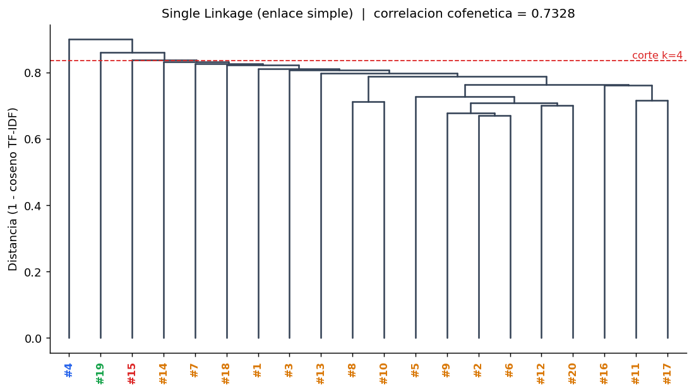

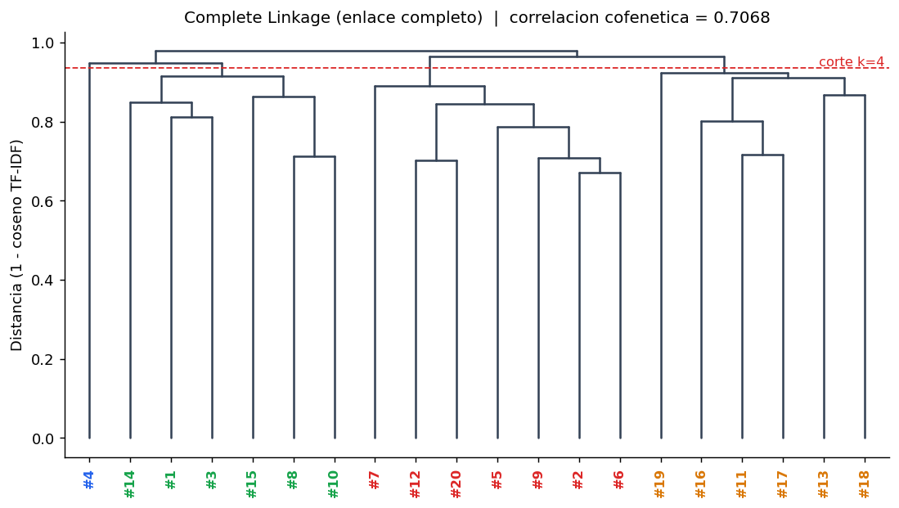

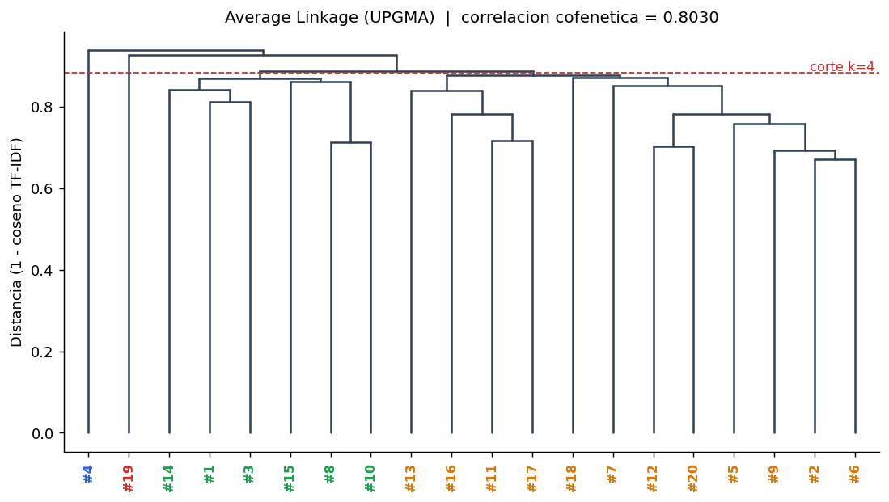

*(La linea roja es un corte en k = 4 grupos; el color de las etiquetas indica el grupo.)*

### 5.4 Evaluacion y conclusion

| Criterio | Correlacion cofenetica | Mejor k (silueta) | Silueta en ese k | Silueta con k = 4 | Ranking por CCC |
|----------------------------------|---------------------:|----------------:|---------------:|----------------:|--------------:|
| Single Linkage (enlace simple) | 0.7328 | 2 | 0.0693 | 0.0170 | 2 |
| Complete Linkage (enlace completo) | 0.7068 | 7 | 0.0639 | 0.0592 | 3 |
| Average Linkage (UPGMA) | 0.8030 | 2 | 0.0693 | 0.0424 | 1 |


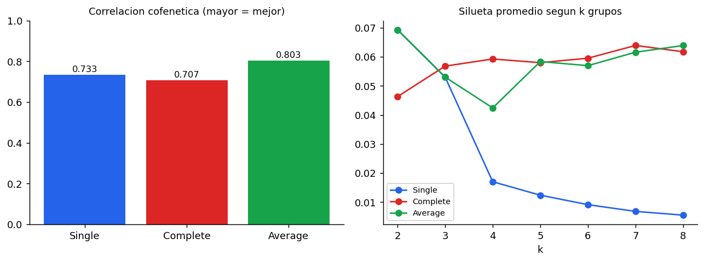

**Grupos con k = 4:**

- Single Linkage (enlace simple): {#4} | {#15} | {#19} | {#1, #2, #3, #5, #6, #7, #8, #9, #10, #11, #12, #13, #14, #16, #17, #18, #20}
- Complete Linkage (enlace completo): {#4} | {#2, #5, #6, #7, #9, #12, #20} | {#1, #3, #8, #10, #14, #15} | {#11, #13, #16, #17, #18, #19}
- Average Linkage (UPGMA): {#4} | {#19} | {#1, #3, #8, #10, #14, #15} | {#2, #5, #6, #7, #9, #11, #12, #13, #16, #17, #18, #20}

**Conclusion.** El criterio mas coherente es **Average Linkage (UPGMA)**, con la mayor correlacion cofenetica (0.8030 frente a 0.7328 de Single y 0.7068 de Complete): su arbol reproduce mejor las distancias originales entre abstracts. Single muestra el encadenamiento esperado: con k = 4 deja tres documentos aislados y un grupo gigante de 17 articulos (silueta 0.0170), poco informativo. Complete forma grupos mas equilibrados (tamanos 1, 7, 6, 6) y tiene la silueta mas alta con k = 4 (0.0592), pero su arbol distorsiona mas las distancias (CCC mas baja). Average combina ambas ventajas razonablemente. **Salvedad honesta:** la silueta es baja en los tres criterios (maximo 0.0693), lo que indica que los abstracts, al ser del mismo dominio y de poca longitud, forman una nube con pocos grupos nitidamente separados; por eso la silueta se usa como criterio de apoyo y la decision se sustenta en la correlacion cofenetica. A modo de lectura tematica, en Complete aparece un grupo con los articulos sobre IA generativa y evaluacion (#11, #13, #16, #17, #18 y #19) y otro con las revisiones generales de IA en educacion (#2, #5, #6, #7, #9, #12 y #20), coherente con sus titulos.

## 6. Requerimiento 3: busqueda de patrones

### 6.1 Explicacion tecnica

La app recibe un patron, lo busca en el abstract de los 20 articulos y muestra documento, posicion (base 0) y fragmento resaltado. Los tres algoritmos se implementan con indices y bucles (sin `find`, `index`, `in`, `replace` ni regex) y devuelven **todas** las ocurrencias, incluidas las superpuestas. Por defecto no distingue mayusculas: se compara texto y patron convertidos con `a_minusculas`, que conserva la longitud y por eso las posiciones sirven para el texto original. Entradas invalidas (patron vacio o de mas de 200 caracteres, texto no cadena, algoritmo desconocido) lanzan `ErrorPatron`; un patron mas largo que el texto devuelve cero ocurrencias.

| Algoritmo | Preprocesamiento | Busqueda: mejor | Busqueda: promedio | Busqueda: peor | Espacio |
|------------------------------------------|----------------------|---------------|------------------|---------------------------------------------------------------|------------|
| KMP | O(m) (tabla LPS) | O(n) | O(n) | O(n) | O(m) |
| Boyer-Moore (caracter malo + sufijo bueno) | O(m + s), s = alfabeto | O(n/m) | ~O(n) | O(n*m) (muchas ocurrencias; no se implemento la regla de Galil) | O(m + s) |
| Rabin-Karp | O(m) | O(n + m) | O(n + m) | O(n*m) (colisiones o hashes iguales siempre) | O(1) |


### 6.2 Caso de estudio

**Patron:** `perspectives` (m = 12). Se eligio porque su tabla LPS **no es trivial** (tiene un borde `pe`) y aparece en el corpus (5 veces; 2 de ellas en el abstract #9). **Texto:** el abstract #9 completo (n = 1245 caracteres), *AI technologies for education: Recent research & future directions*. Ocurrencias encontradas por los tres algoritmos: posiciones **24 y 1002**.

> From unique educational perspectives, this article reports a comprehensive review of selected empirical studies on artificial intelligence in education (AIEd) published in 1993 – 2020, as collected in the Web of Sciences database and selected AIEd-specialized journals. A total of 40 empirical studies met all selection criteria, and were fully reviewed using multiple methods, including selected bibliometrics, content analysis and categorical meta-trends analysis. This article reports the current state of AIEd research, highlights selected AIEd technologies and applications, reviews their proven and potential benefits for education, bridges the gaps between AI technological innovations and their educational applications, and generates practical examples and inspirations for both technological experts that create AIEd technologies and educators who spearhead AI innovations in education. It also provides rich discussions on practical implications and future research directions from multiple perspectives. The advancement of AIEd calls for critical initiatives to address AI ethics and privacy concerns, and requires interdisciplinary and transdisciplinary collaborations in large-scaled, longitudinal research and development efforts.

#### 6.2.1 KMP: tabla LPS

`lps[i]` = longitud del prefijo propio mas largo de `P[0..i]` que tambien es sufijo. `lps[4] = 1` porque `p` (P[4]) coincide con `p` (P[0]); `lps[5] = 2` porque `pe` (P[4..5]) coincide con `pe` (P[0..1]).

| i | 0 | 1 | 2 | 3 | 4 | 5 | 6 | 7 | 8 | 9 | 10 | 11 |
|------------|------------|------------|------------|------------|------------|------------|------------|------------|------------|------------|------------|------------|
| P[i] | p | e | r | s | p | e | c | t | i | v | e | s |
| lps[i] | 0 | 0 | 0 | 0 | 1 | 2 | 0 | 0 | 0 | 0 | 0 | 0 |


En una falla despues de emparejar j caracteres, el patron se desplaza usando `j = lps[j-1]` y **el texto nunca retrocede**. Resultado sobre el abstract: 1273 comparaciones con n = 1245 (KMP hace como maximo 2n comparaciones).

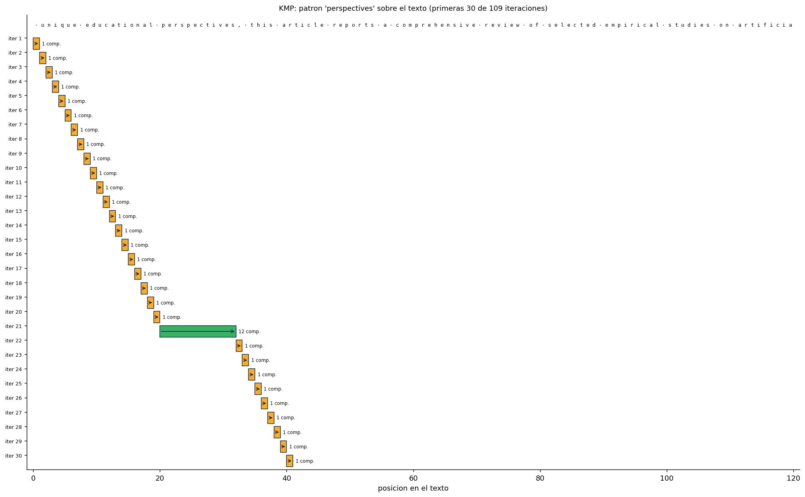

#### 6.2.2 Boyer-Moore: tablas heuristicas

**Tabla del caracter malo** (ultima posicion de cada caracter en el patron; los caracteres que no estan valen -1):

| Caracter | c | e | i | p | r | s | t | v |
|---------------|------------|------------|------------|------------|------------|------------|------------|------------|
| ultima posicion | 6 | 10 | 8 | 4 | 2 | 11 | 7 | 9 |


**Tabla del sufijo bueno** `shift[k]`: avance cuando la comparacion falla en la posicion j = k - 1 habiendo coincidido ya el sufijo P[k..m-1]; `shift[0]` es el avance tras una coincidencia completa. `borde[k]` es la tabla auxiliar de bordes con la que se construye:

| k | 0 | 1 | 2 | 3 | 4 | 5 | 6 | 7 | 8 | 9 | 10 | 11 | 12 |
|------------|------------|------------|------------|------------|------------|------------|------------|------------|------------|------------|------------|------------|------------|
| shift[k] | 12 | 12 | 12 | 12 | 12 | 12 | 12 | 12 | 12 | 12 | 12 | 8 | 1 |
| borde[k] | 12 | 12 | 12 | 11 | 12 | 12 | 12 | 12 | 12 | 12 | 12 | 12 | 13 |


Se compara de derecha a izquierda y, ante una falla en la posicion j con el caracter `c` del texto, el patron avanza `max(j - ultima[c], shift[j+1])`. Sobre el abstract hubo 135 alineamientos y 165 comparaciones (frente a n = 1245 caracteres): Boyer-Moore **salta** gran parte del texto.

Primeras iteraciones reales:

| Alineamiento s | Falla en j | Caracter del texto | Desp. caracter malo | Desp. sufijo bueno | Regla usada | Avance |
|-------------:|-----------:|------------------|------------------:|-----------------:|------------------------------------|-----------:|
| 0 | 11 | ` ` | 12 | 1 | caracter malo | 12 |
| 12 | 11 | ` ` | 12 | 1 | caracter malo | 12 |
| 24 | -1 | `-` | None | 12 | coincidencia completa (sufijo bueno) | 12 |
| 36 | 11 | `c` | 5 | 1 | caracter malo | 5 |
| 41 | 11 | `e` | 1 | 1 | caracter malo | 1 |
| 42 | 11 | `p` | 7 | 1 | caracter malo | 7 |
| 49 | 11 | ` ` | 12 | 1 | caracter malo | 12 |
| 61 | 11 | `v` | 2 | 1 | caracter malo | 2 |


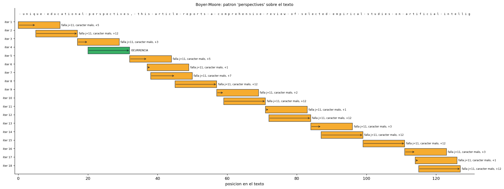

#### 6.2.3 Rabin-Karp: hash inicial, hash rodante y colisiones

Se usa el hash polinomial `h = (c0*B^(m-1) + c1*B^(m-2) + ... + c(m-1)) mod q` con base B = 256 y modulo q = 1000000007 (primo). Valores ASCII del patron: `p`=112, `e`=101, `r`=114, `s`=115, `p`=112, `e`=101, `c`=99, `t`=116, `i`=105, `v`=118, `e`=101, `s`=115.

**Hash del patron** (Horner) = **791898702**. **B^(m-1) mod q** = 140130951. **Hash de la primera ventana** `from unique ` = **543860792**.

**Hash rodante:** `h(s+1) = ((h(s) - T[s] * B^(m-1)) * B + T[s+m]) mod q`. Verificacion numerica de las primeras ventanas contra el calculo directo:

| s | hash de la ventana s | sale | entra | hash rodante s+1 | hash directo s+1 | coinciden |
|-----------:|-------------------:|------------|------------|---------------:|---------------:|------------|
| 0 | 543860792 | `f` | `e` | 128994981 | 128994981 | si |
| 1 | 128994981 | `r` | `d` | 441069651 | 441069651 | si |
| 2 | 441069651 | `o` | `u` | 952754247 | 952754247 | si |


**Colisiones.** Cuando el hash de una ventana es igual al del patron se verifica caracter por caracter: si no es igual, es una *colision* (falso positivo). Efecto del modulo sobre este mismo texto (1234 ventanas):

| Modulo q | Hash del patron | Colisiones | Ocurrencias reales |
|-----------:|--------------:|-----------:|-----------------:|
| 11 | 1 | 98 | 2 |
| 31 | 8 | 41 | 2 |
| 101 | 63 | 13 | 2 |
| 211 | 183 | 7 | 2 |
| 1009 | 215 | 0 | 2 |
| 10007 | 8341 | 0 | 2 |
| 1000000007 | 791898702 | 0 | 2 |


Con q = 101 (demostracion) el hash del patron es 63 y hay 13 colisiones reales; ejemplos:

| Posicion s | Ventana | Hash | Hash del patron | Resultado |
|-----------:|--------------|-----------:|--------------:|--------------------------------------|
| 166 | `ed in 1993 –` | 63 | 63 | colision (los caracteres no coinciden) |
| 175 | `3 – 2020, as` | 63 | 63 | colision (los caracteres no coinciden) |
| 183 | `, as collect` | 63 | 63 | colision (los caracteres no coinciden) |
| 215 | `ences databa` | 63 | 63 | colision (los caracteres no coinciden) |
| 293 | ` studies met` | 63 | 63 | colision (los caracteres no coinciden) |


En todos los casos el resultado final fue correcto (posiciones 24 y 1002), porque cada coincidencia de hash se verifica. Con el modulo grande no hubo colisiones.

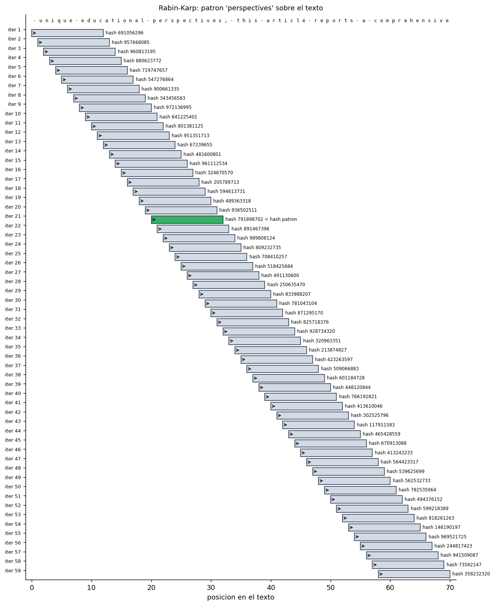

*(Las graficas muestran un fragmento centrado en la primera ocurrencia: barras = alineamiento del patron; flechas = desplazamiento; verde = ocurrencia; gris = ventana sin coincidencia.)*

### 6.3 Analisis critico: Big O teorica frente a tiempos reales

**Corpus completo** (n = 28097 caracteres, mediana de 15 corridas; tiempos de preprocesamiento y de busqueda por separado):

| Patron | m | Algoritmo | Preproc. (ms) | Busqueda (ms) | Comparaciones | Ocurrencias |
|------------------------------------|-----------:|------------|------------:|------------:|------------:|-----------:|
| ai | 2 | kmp | 0.0013 | 2.65 | 29954 | 170 |
| ai | 2 | boyer-moore | 0.0098 | 6.45 | 15656 | 170 |
| ai | 2 | rabin-karp | 0.0042 | 5.41 | 340 | 170 |
| learning | 8 | kmp | 0.0019 | 2.28 | 29026 | 40 |
| learning | 8 | boyer-moore | 0.0127 | 2.08 | 4962 | 40 |
| learning | 8 | rabin-karp | 0.0066 | 7.57 | 320 | 40 |
| perspectives | 12 | kmp | 0.0023 | 2.24 | 28598 | 5 |
| perspectives | 12 | boyer-moore | 0.0153 | 1.53 | 3375 | 5 |
| perspectives | 12 | rabin-karp | 0.0069 | 7.07 | 60 | 5 |
| artificial intelligence in education | 36 | kmp | 0.0035 | 2.36 | 30090 | 6 |
| artificial intelligence in education | 36 | boyer-moore | 0.0249 | 0.86 | 2604 | 6 |
| artificial intelligence in education | 36 | rabin-karp | 0.0088 | 7.82 | 216 | 6 |
| systematic review of the literature | 35 | kmp | 0.0034 | 2.49 | 29782 | 0 |
| systematic review of the literature | 35 | boyer-moore | 0.0248 | 0.76 | 1992 | 0 |
| systematic review of the literature | 35 | rabin-karp | 0.0061 | 7.10 | 0 | 0 |


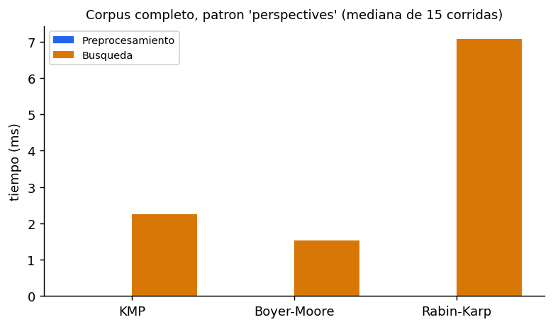

**Escalabilidad:** el corpus se repite k veces (patron `perspectives`). Si la busqueda es lineal, el tiempo debe crecer proporcional a n.

| k | n (caracteres) | KMP (ms) | Boyer-Moore (ms) | Rabin-Karp (ms) |
|-----------:|-------------:|-----------:|---------------:|--------------:|
| 1 | 28097 | 2.2 | 1.3 | 6.9 |
| 2 | 56195 | 4.3 | 2.7 | 13.8 |
| 4 | 112391 | 8.6 | 5.3 | 27.7 |
| 8 | 224783 | 17.3 | 10.7 | 55.5 |
| 16 | 449567 | 34.4 | 21.3 | 110.8 |
| 32 | 899135 | 69.0 | 42.5 | 220.5 |


Al multiplicar n por 32, el tiempo se multiplico por 32.0 (KMP), 32.2 (Boyer-Moore) y 31.8 (Rabin-Karp): **crecimiento lineal**, como predice O(n).

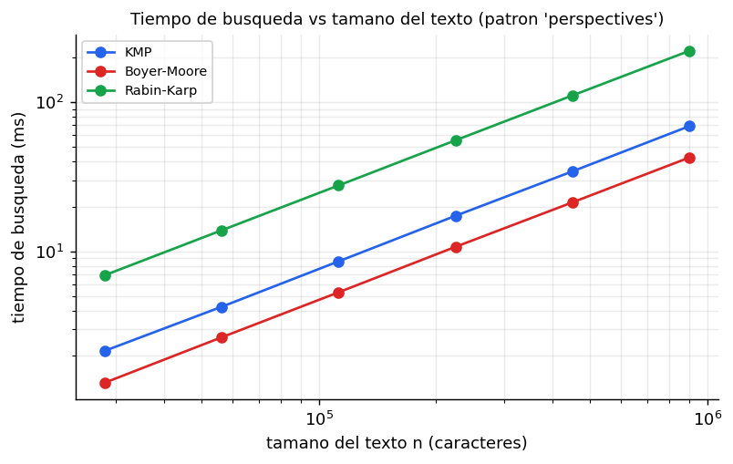

**Casos limite sinteticos** (n = 20000, m = 40; textos artificiales, no del corpus):

| Caso | KMP | Boyer-Moore | Rabin-Karp |
|----------------------------------------------------------------------|--------------------|----------------------|----------------------|
| Sin ocurrencias, alfabeto distinto (mejor caso de Boyer-Moore) | 1.5 ms / 20000 comp. | 0.2 ms / 500 comp. | 4.8 ms / 0 comp. |
| Casi coincide siempre: patron a^(m-1)b sobre a^n | 3.0 ms / 39961 comp. | 8.2 ms / 19961 comp. | 4.9 ms / 0 comp. |
| Todas las posiciones coinciden: patron a^m sobre a^n (peor caso de BM y RK) | 2.4 ms / 20000 comp. | 58.6 ms / 798440 comp. | 64.7 ms / 798440 comp. |


**Lectura.**

1. **Boyer-Moore, mejor caso:** sin ocurrencias y con un alfabeto distinto, hizo 500 comparaciones = n/m = 500, frente a 20000 de KMP: salta de m en m. En el corpus real, con m = 12 hizo 3375 comparaciones frente a 28598 de KMP.

2. **Peor caso O(n*m):** con el patron a^m sobre a^n, Boyer-Moore y Rabin-Karp hicieron 798440 comparaciones (= (n - m + 1) x m = 798440), mientras KMP se mantuvo en 20000 (lineal). El tiempo lo confirma: 58.6 ms (Boyer-Moore) y 64.7 ms (Rabin-Karp) frente a 2.4 ms (KMP).

3. **Preprocesamiento frente a busqueda:** el preprocesamiento es despreciable (0.0023 ms KMP, 0.0153 ms Boyer-Moore, 0.0069 ms Rabin-Karp) frente a la busqueda (2.24, 1.53 y 7.07 ms) porque el patron mide 12 caracteres y el texto 28097. Boyer-Moore paga el preprocesamiento mas caro (dos tablas, O(m + s)) pero lo recupera al saltar.

4. **Rabin-Karp hace menos comparaciones de caracteres pero es el mas lento en Python** (7.07 ms frente a 2.24 de KMP): hace muy pocas comparaciones (solo verifica coincidencias de hash), pero actualiza un hash con multiplicaciones y modulo en cada ventana. El conteo de comparaciones no es el unico factor: el costo por operacion tambien importa. Con patrones muy cortos (`ai`, m = 2) Boyer-Moore pierde su ventaja porque los saltos son minimos.

5. Los tiempos absolutos dependen de la maquina (aqui 1 CPU, Python 3.12.3) y del lenguaje; lo que se contrasta con la teoria es la **forma de crecimiento y el numero de comparaciones**, que si son independientes de la maquina.

## 7. Despliegue, pruebas y calidad

**Despliegue (Render).** `Procfile`: `web: gunicorn src.api:app --bind 0.0.0.0:$PORT --workers 1 --timeout 120`. `render.yaml` describe el servicio (plan gratuito, `pip install -r requirements.txt`). `requirements.txt` solo contiene Flask, matplotlib y gunicorn. Los datos (`data/processed/*.json`, ~259 KB) viajan en el repositorio; los PDFs y los modelos de embeddings **no**. Las rutas se configuran con `BIBLIO_DATA_DIR`/`BIBLIO_REPORTS_DIR` y, si no se puede escribir, se usa una carpeta temporal. Pasos exactos en `README.md`.

**Pruebas (`pytest`).** Casos conocidos (por ejemplo `Levenshtein(kitten, sitting) = 3`; Needleman-Wunsch GATTACA/GCATGCU = 0; LPS de `ABABCABAB`), calculo a mano de TF-IDF y de las tres alturas de enlace, contraste del clustering con scipy, 2.500 casos aleatorios donde KMP, Boyer-Moore y Rabin-Karp coinciden con una referencia independiente, tabla del sufijo bueno contra su definicion, colisiones de Rabin-Karp con modulo pequeno, y manejo de errores: PDF sin abstract, entradas vacias, patron mas largo que el texto, articulo inexistente, menos de dos articulos, API con JSON invalido.

**Limites de la web:** de 2 a 6 articulos por comparacion y patrones de hasta 200 caracteres.

## 8. Conclusiones

- Se implemento desde cero toda la logica algoritmica pedida y se verifico con pruebas y, solo en pruebas, contra scipy.
- **Similitud:** ninguna medida es "la mejor": miden forma, vocabulario o significado aproximado. En este corpus, TF-IDF discrimina mejor; Levenshtein y Needleman-Wunsch casi no distinguen temas; los embeddings promediados comprimen los valores hacia arriba.
- **Clustering:** Average Linkage es el criterio mas coherente por correlacion cofenetica (0.8030); la silueta baja en los tres refleja un corpus homogeneo.
- **Patrones:** los tres algoritmos devuelven exactamente las mismas posiciones; los tiempos crecen linealmente con n y el peor caso O(n*m) de Boyer-Moore y Rabin-Karp se observo de forma directa en las comparaciones.

## 9. Limitaciones y trabajo futuro

- Solo se procesan 20 abstracts en ingles; el stemming es simple (reglas de sufijos) y puede unir o separar formas incorrectamente (por ejemplo `series` -> `sery`).
- Los embeddings son promedios de vectores de palabras estaticos: pierden orden y contexto. Trabajo futuro: modelos de oraciones tipo Transformer (script opcional incluido pero **no ejecutado**), ponderar el promedio con IDF y restar la componente comun (el diagnostico de la seccion 4.3 sugiere que ayudaria, pero no se evaluo como metodo).
- La silueta es baja; un corpus mayor o abstracts mas diversos permitirian grupos mas separados. Falta probar el criterio de Ward con distancias euclidianas.
- Boyer-Moore no incluye la regla de Galil (peor caso O(n*m) con muchas ocurrencias). Posible extension: Aho-Corasick para varios patrones y busqueda aproximada.
- El plan gratuito de Render duerme tras inactividad: la primera consulta puede tardar; Levenshtein/Needleman-Wunsch con 6 articulos (15 pares) son los calculos mas pesados.
- Los tiempos reportados corresponden a una sola maquina; deben repetirse en el equipo del grupo para la sustentacion.

## 10. Declaracion de uso de IA generativa

> **Borrador redactado por la herramienta de IA; el grupo debe leerlo y ajustarlo a lo que realmente hizo cada integrante antes de entregarlo.**

Se utilizo **Claude (Anthropic)** como asistente de desarrollo durante el proyecto. Su aporte fue de **apoyo**:
- Genero borradores de codigo (implementacion de los algoritmos, API, interfaz web), pruebas unitarias y la redaccion inicial de la documentacion, a partir de los requerimientos y decisiones indicados por el grupo (por ejemplo, la eleccion de modelos de embeddings, criterios de enlace y estructura del repositorio).
- Ejecuto el codigo en su entorno para producir las evidencias numericas, figuras y tablas del documento; ninguna cifra se escribio a mano.
- Los modelos preentrenados de embeddings (GloVe y fastText) son modelos de terceros usados como insumo, descritos en la seccion 4.

**Lo que la IA no reemplaza:** el grupo es responsable de comprender cada algoritmo (formulas, complejidad y casos de estudio), de revisar y ejecutar el codigo, de verificar los resultados (las pruebas y la comparacion con scipy estan en el repositorio) y de sustentarlos. La *Guia de sustentacion* incluye explicaciones y ejemplos manuales para ese fin. Las referencias bibliograficas se incluyeron de memoria del asistente: **deben verificarse** contra las fuentes originales antes de la entrega.

## 11. Referencias

*(Citadas de memoria; verificar volumen, paginas y anio en las fuentes originales.)*

- V. I. Levenshtein, "Binary codes capable of correcting deletions, insertions and reversals", *Soviet Physics Doklady*, 10(8), 707-710, 1966.
- S. B. Needleman y C. D. Wunsch, "A general method applicable to the search for similarities in the amino acid sequence of two proteins", *Journal of Molecular Biology*, 48(3), 443-453, 1970.
- P. Jaccard, "Distribution de la flore alpine dans le bassin des Dranses et dans quelques regions voisines", *Bulletin de la Societe Vaudoise des Sciences Naturelles*, 37, 241-272, 1901.
- G. Salton y C. Buckley, "Term-weighting approaches in automatic text retrieval", *Information Processing & Management*, 24(5), 513-523, 1988.
- D. E. Knuth, J. H. Morris y V. R. Pratt, "Fast pattern matching in strings", *SIAM Journal on Computing*, 6(2), 323-350, 1977.
- R. S. Boyer y J. S. Moore, "A fast string searching algorithm", *Communications of the ACM*, 20(10), 762-772, 1977.
- R. M. Karp y M. O. Rabin, "Efficient randomized pattern-matching algorithms", *IBM Journal of Research and Development*, 31(2), 249-260, 1987.
- R. R. Sokal y C. D. Michener, "A statistical method for evaluating systematic relationships", *University of Kansas Science Bulletin*, 38, 1409-1438, 1958.
- R. R. Sokal y F. J. Rohlf, "The comparison of dendrograms by objective methods", *Taxon*, 11(2), 33-40, 1962.
- P. J. Rousseeuw, "Silhouettes: a graphical aid to the interpretation and validation of cluster analysis", *Journal of Computational and Applied Mathematics*, 20, 53-65, 1987.
- J. Pennington, R. Socher y C. D. Manning, "GloVe: Global vectors for word representation", *Proc. EMNLP*, 1532-1543, 2014.
- T. Mikolov, E. Grave, P. Bojanowski, C. Puhrsch y A. Joulin, "Advances in pre-training distributed word representations", *Proc. LREC*, 2018.
- T. H. Cormen, C. E. Leiserson, R. L. Rivest y C. Stein, *Introduction to Algorithms*, MIT Press (capitulos de programacion dinamica y de coincidencia de cadenas).

**Corpus analizado (20 articulos):**

1. Matthias Carl Laupichler, Alexandra Aster, Jana Schirch, Tobias Raupach. *Artificial intelligence literacy in higher and adult education: A scoping literature review*.
2. Thomas K.F. Chiu, Qi Xia, Xinyan Zhou, Ching Sing Chai, Miaoting Cheng. *Systematic literature review on opportunities, challenges, and future research recommendations of artificial intelligence in education*.
3. Arne Bewersdorff, Xiaoming Zhai, Jessica Roberts, Claudia Nerdel. *Myths, mis- and preconceptions of artificial intelligence: A review of the literature*.
4. Srecko Joksimovic, Dirk Ifenthaler, Rebecca Marrone, Maarten De Laat, George Siemens. *Opportunities of artificial intelligence for supporting complex problem-solving: Findings from a scoping review*.
5. Xieling Chen, Haoran Xie, Di Zou, Gwo-Jen Hwang. *Application and theory gaps during the rise of Artificial Intelligence in Education*.
6. Xieling Chen, Haoran Xie, Gwo-Jen Hwang. *A multi-perspective study on Artificial Intelligence in Education: grants, conferences, journals, software tools, institutions, and researchers*.
7. Riordan Alfredo, Vanessa Echeverria, Yueqiao Jin, Lixiang Yan, Zachari Swiecki, Dragan Gašević, Roberto Martinez-Maldonado. *Human-centred learning analytics and AI in education: A systematic literature review*.
8. Seng Chee Tan, Alwyn Vwen Yen Lee, Min Lee. *A systematic review of artificial intelligence techniques for collaborative learning over the past two decades*.
9. Ke Zhang, Ayse Begum Aslan. *AI technologies for education: Recent research & future directions*.
10. Chih-Pu Dai, Fengfeng Ke. *Educational applications of artificial intelligence in simulation-based learning: A systematic mapping review*.
11. Qi Xia, Xiaojing Weng, Fan Ouyang, Tzung Jin Lin, Thomas K.F. Chiu. *A scoping review on how generative artificial intelligence transforms assessment in higher education*.
12. Melissa Bond, Hassan Khosravi, Maarten De Laat, Nina Bergdahl, Violeta Negrea, Emily Oxley, Phuong Pham, Sin Wang Chong, George Siemens. *A meta systematic review of artificial intelligence in higher education: a call for increased ethics, collaboration, and rigour*.
13. Jyoti Mudkanna Gavhane, Reena Pagare. *Artificial intelligence for education and its emphasis on assessment and adversity quotient: a review*.
14. Tamar Mikeladze, Paulien C. Meijer, Roald P. Verhoeff. *A comprehensive exploration of artificial intelligence competence frameworks for educators: A critical review*.
15. Bayode Ogunleye, Kudirat Ibilola Zakariyyah, Oluwaseun Ajao, Olakunle Olayinka, Hemlata Sharma. *A Systematic Review of Generative AI for Teaching and Learning Practice*.
16. Che Yee Lye, Lyndon Lim. *Generative Artificial Intelligence in Tertiary Education: Assessment Redesign Principles and Considerations*.
17. Fan Ouyang, Tuan Anh Dinh, Weiqi Xu. *A Systematic Review of AI-Driven Educational Assessment in STEM Education*.
18. Zied Bahroun, Chiraz Anane, Vian Ahmed, Andrew Zacca. *Transforming Education: A Comprehensive Review of Generative Artificial Intelligence in Educational Settings through Bibliometric and Content Analysis*.
19. Chung Kwan Lo. *What Is the Impact of ChatGPT on Education? A Rapid Review of the Literature*.
20. Olaf Zawacki-Richter, Victoria I. Marín, Melissa Bond, Franziska Gouverneur. *Systematic review of research on artificial intelligence applications in higher education – where are the educators?*.

## Anexo A. Tabla completa de terminos TF-IDF del caso de estudio (#2 y #6)

Ordenados por aporte al producto punto. N = 20; IDF = ln(21/(1+df)) + 1.

| Termino | df | IDF | TF A | TF B | w A | w B | w A x w B |
|------------|-----------:|-----------:|-----------:|-----------:|-----------:|-----------:|-----------:|
| aied | 7 | 1.965 | 0.0676 | 0.0686 | 0.1328 | 0.1349 | 0.01791 |
| researcher | 5 | 2.253 | 0.0135 | 0.0294 | 0.0304 | 0.0663 | 0.00202 |
| relevant | 7 | 1.965 | 0.0135 | 0.0294 | 0.0266 | 0.0578 | 0.00153 |
| educate | 18 | 1.100 | 0.0405 | 0.0294 | 0.0446 | 0.0324 | 0.00144 |
| major | 2 | 2.946 | 0.0135 | 0.0098 | 0.0398 | 0.0289 | 0.00115 |
| new | 3 | 2.658 | 0.0135 | 0.0098 | 0.0359 | 0.0261 | 0.00094 |
| technology | 12 | 1.480 | 0.0405 | 0.0098 | 0.0600 | 0.0145 | 0.00087 |
| aim | 4 | 2.435 | 0.0135 | 0.0098 | 0.0329 | 0.0239 | 0.00079 |
| research | 16 | 1.211 | 0.0270 | 0.0196 | 0.0327 | 0.0238 | 0.00078 |
| identify | 10 | 1.647 | 0.0135 | 0.0196 | 0.0223 | 0.0323 | 0.00072 |
| study | 14 | 1.336 | 0.0135 | 0.0294 | 0.0181 | 0.0393 | 0.00071 |
| applicate | 11 | 1.560 | 0.0135 | 0.0196 | 0.0211 | 0.0306 | 0.00064 |
| literature | 11 | 1.560 | 0.0270 | 0.0098 | 0.0422 | 0.0153 | 0.00064 |
| ai | 18 | 1.100 | 0.0270 | 0.0196 | 0.0297 | 0.0216 | 0.00064 |
| present | 6 | 2.099 | 0.0135 | 0.0098 | 0.0284 | 0.0206 | 0.00058 |
| understand | 10 | 1.647 | 0.0135 | 0.0098 | 0.0223 | 0.0161 | 0.00036 |
| artificial | 20 | 1.000 | 0.0135 | 0.0196 | 0.0135 | 0.0196 | 0.00026 |
| intelligence | 20 | 1.000 | 0.0135 | 0.0196 | 0.0135 | 0.0196 | 0.00026 |
| able | 2 | 2.946 | 0.0000 | 0.0098 | 0.0000 | 0.0289 | 0.00000 |
| active | 2 | 2.946 | 0.0000 | 0.0196 | 0.0000 | 0.0578 | 0.00000 |
| actor | 1 | 3.351 | 0.0000 | 0.0098 | 0.0000 | 0.0329 | 0.00000 |
| addition | 2 | 2.946 | 0.0000 | 0.0098 | 0.0000 | 0.0289 | 0.00000 |
| administrate | 1 | 3.351 | 0.0135 | 0.0000 | 0.0453 | 0.0000 | 0.00000 |
| alike | 1 | 3.351 | 0.0135 | 0.0000 | 0.0453 | 0.0000 | 0.00000 |
| analysis | 7 | 1.965 | 0.0135 | 0.0000 | 0.0266 | 0.0000 | 0.00000 |
| approach | 8 | 1.847 | 0.0135 | 0.0000 | 0.0250 | 0.0000 | 0.00000 |
| article | 4 | 2.435 | 0.0000 | 0.0098 | 0.0000 | 0.0239 | 0.00000 |
| assessment | 10 | 1.647 | 0.0135 | 0.0000 | 0.0223 | 0.0000 | 0.00000 |
| aware | 1 | 3.351 | 0.0000 | 0.0098 | 0.0000 | 0.0329 | 0.00000 |
| challeng | 6 | 2.099 | 0.0270 | 0.0000 | 0.0567 | 0.0000 | 0.00000 |
| cod | 5 | 2.253 | 0.0135 | 0.0000 | 0.0304 | 0.0000 | 0.00000 |
| computer | 4 | 2.435 | 0.0000 | 0.0098 | 0.0000 | 0.0239 | 0.00000 |
| concern | 4 | 2.435 | 0.0000 | 0.0196 | 0.0000 | 0.0477 | 0.00000 |
| conferenc | 1 | 3.351 | 0.0000 | 0.0098 | 0.0000 | 0.0329 | 0.00000 |
| content | 6 | 2.099 | 0.0135 | 0.0000 | 0.0284 | 0.0000 | 0.00000 |
| context | 7 | 1.965 | 0.0000 | 0.0098 | 0.0000 | 0.0193 | 0.00000 |
| continuous | 1 | 3.351 | 0.0000 | 0.0098 | 0.0000 | 0.0329 | 0.00000 |
| contribute | 1 | 3.351 | 0.0000 | 0.0098 | 0.0000 | 0.0329 | 0.00000 |
| current | 9 | 1.742 | 0.0135 | 0.0000 | 0.0235 | 0.0000 | 0.00000 |
| development | 5 | 2.253 | 0.0000 | 0.0392 | 0.0000 | 0.0883 | 0.00000 |
| direction | 3 | 2.658 | 0.0135 | 0.0000 | 0.0359 | 0.0000 | 0.00000 |
| domain | 6 | 2.099 | 0.0270 | 0.0000 | 0.0567 | 0.0000 | 0.00000 |
| educator | 5 | 2.253 | 0.0000 | 0.0294 | 0.0000 | 0.0663 | 0.00000 |
| elsevier | 1 | 3.351 | 0.0000 | 0.0098 | 0.0000 | 0.0329 | 0.00000 |
| emerg | 5 | 2.253 | 0.0135 | 0.0000 | 0.0304 | 0.0000 | 0.00000 |
| enabl | 1 | 3.351 | 0.0000 | 0.0098 | 0.0000 | 0.0329 | 0.00000 |
| examin | 4 | 2.435 | 0.0270 | 0.0000 | 0.0658 | 0.0000 | 0.00000 |
| field | 8 | 1.847 | 0.0000 | 0.0098 | 0.0000 | 0.0181 | 0.00000 |
| find | 11 | 1.560 | 0.0000 | 0.0098 | 0.0000 | 0.0153 | 0.00000 |
| focus | 6 | 2.099 | 0.0135 | 0.0000 | 0.0284 | 0.0000 | 0.00000 |
| four | 3 | 2.658 | 0.0135 | 0.0000 | 0.0359 | 0.0000 | 0.00000 |
| furthermore | 3 | 2.658 | 0.0000 | 0.0098 | 0.0000 | 0.0261 | 0.00000 |
| future | 11 | 1.560 | 0.0135 | 0.0000 | 0.0211 | 0.0000 | 0.00000 |
| grant | 1 | 3.351 | 0.0000 | 0.0196 | 0.0000 | 0.0657 | 0.00000 |
| grow | 2 | 2.946 | 0.0000 | 0.0098 | 0.0000 | 0.0289 | 0.00000 |
| growth | 2 | 2.946 | 0.0000 | 0.0098 | 0.0000 | 0.0289 | 0.00000 |
| help | 4 | 2.435 | 0.0000 | 0.0098 | 0.0000 | 0.0239 | 0.00000 |
| highlight | 4 | 2.435 | 0.0000 | 0.0098 | 0.0000 | 0.0239 | 0.00000 |
| implementate | 2 | 2.946 | 0.0000 | 0.0098 | 0.0000 | 0.0289 | 0.00000 |
| institution | 4 | 2.435 | 0.0000 | 0.0196 | 0.0000 | 0.0477 | 0.00000 |
| integrat | 2 | 2.946 | 0.0135 | 0.0000 | 0.0398 | 0.0000 | 0.00000 |
| interest | 3 | 2.658 | 0.0000 | 0.0098 | 0.0000 | 0.0261 | 0.00000 |
| issu | 4 | 2.435 | 0.0000 | 0.0196 | 0.0000 | 0.0477 | 0.00000 |
| journal | 6 | 2.099 | 0.0000 | 0.0392 | 0.0000 | 0.0823 | 0.00000 |
| key | 4 | 2.435 | 0.0270 | 0.0000 | 0.0658 | 0.0000 | 0.00000 |
| last | 3 | 2.658 | 0.0135 | 0.0000 | 0.0359 | 0.0000 | 0.00000 |
| launch | 2 | 2.946 | 0.0000 | 0.0098 | 0.0000 | 0.0289 | 0.00000 |
| learn | 12 | 1.480 | 0.0405 | 0.0000 | 0.0600 | 0.0000 | 0.00000 |
| matrix | 1 | 3.351 | 0.0135 | 0.0000 | 0.0453 | 0.0000 | 0.00000 |
| multiple | 2 | 2.946 | 0.0000 | 0.0098 | 0.0000 | 0.0289 | 0.00000 |
| nam | 1 | 3.351 | 0.0000 | 0.0098 | 0.0000 | 0.0329 | 0.00000 |
| necessity | 1 | 3.351 | 0.0000 | 0.0098 | 0.0000 | 0.0329 | 0.00000 |
| neglect | 1 | 3.351 | 0.0135 | 0.0000 | 0.0453 | 0.0000 | 0.00000 |
| opportunity | 4 | 2.435 | 0.0135 | 0.0000 | 0.0329 | 0.0000 | 0.00000 |
| outcom | 3 | 2.658 | 0.0270 | 0.0000 | 0.0718 | 0.0000 | 0.00000 |
| overview | 5 | 2.253 | 0.0000 | 0.0098 | 0.0000 | 0.0221 | 0.00000 |
| perspectiv | 4 | 2.435 | 0.0000 | 0.0098 | 0.0000 | 0.0239 | 0.00000 |
| practitioner | 1 | 3.351 | 0.0135 | 0.0000 | 0.0453 | 0.0000 | 0.00000 |
| provid | 5 | 2.253 | 0.0135 | 0.0000 | 0.0304 | 0.0000 | 0.00000 |
| provide | 10 | 1.647 | 0.0000 | 0.0098 | 0.0000 | 0.0161 | 0.00000 |
| publicate | 5 | 2.253 | 0.0000 | 0.0098 | 0.0000 | 0.0221 | 0.00000 |
| rapid | 4 | 2.435 | 0.0000 | 0.0098 | 0.0000 | 0.0239 | 0.00000 |
| relat | 4 | 2.435 | 0.0000 | 0.0098 | 0.0000 | 0.0239 | 0.00000 |
| relate | 1 | 3.351 | 0.0000 | 0.0098 | 0.0000 | 0.0329 | 0.00000 |
| relationship | 4 | 2.435 | 0.0135 | 0.0000 | 0.0329 | 0.0000 | 0.00000 |
| result | 8 | 1.847 | 0.0135 | 0.0000 | 0.0250 | 0.0000 | 0.00000 |
| review | 18 | 1.100 | 0.0405 | 0.0000 | 0.0446 | 0.0000 | 0.00000 |
| rol | 1 | 3.351 | 0.0135 | 0.0000 | 0.0453 | 0.0000 | 0.00000 |
| scholar | 4 | 2.435 | 0.0000 | 0.0196 | 0.0000 | 0.0477 | 0.00000 |
| scientific | 1 | 3.351 | 0.0000 | 0.0098 | 0.0000 | 0.0329 | 0.00000 |
| significance | 1 | 3.351 | 0.0000 | 0.0098 | 0.0000 | 0.0329 | 0.00000 |
| significant | 4 | 2.435 | 0.0000 | 0.0098 | 0.0000 | 0.0239 | 0.00000 |
| software | 1 | 3.351 | 0.0000 | 0.0098 | 0.0000 | 0.0329 | 0.00000 |
| status | 2 | 2.946 | 0.0000 | 0.0098 | 0.0000 | 0.0289 | 0.00000 |
| student | 8 | 1.847 | 0.0135 | 0.0000 | 0.0250 | 0.0000 | 0.00000 |
| suggestion | 4 | 2.435 | 0.0135 | 0.0000 | 0.0329 | 0.0000 | 0.00000 |
| systematic | 10 | 1.647 | 0.0135 | 0.0000 | 0.0223 | 0.0000 | 0.00000 |
| teach | 6 | 2.099 | 0.0135 | 0.0000 | 0.0284 | 0.0000 | 0.00000 |
| teacher | 5 | 2.253 | 0.0135 | 0.0000 | 0.0304 | 0.0000 | 0.00000 |
| term | 5 | 2.253 | 0.0000 | 0.0098 | 0.0000 | 0.0221 | 0.00000 |
| tool | 5 | 2.253 | 0.0000 | 0.0098 | 0.0000 | 0.0221 | 0.00000 |
| top | 1 | 3.351 | 0.0000 | 0.0098 | 0.0000 | 0.0329 | 0.00000 |
| trend | 6 | 2.099 | 0.0000 | 0.0098 | 0.0000 | 0.0206 | 0.00000 |
| year | 5 | 2.253 | 0.0135 | 0.0000 | 0.0304 | 0.0000 | 0.00000 |


## Anexo B. Matriz de distancias (1 - coseno TF-IDF) entre los 20 abstracts

*Bloque: columnas #1 a #10*

|  | #1 | #2 | #3 | #4 | #5 | #6 | #7 | #8 | #9 | #10 |
|------------|-----------:|-----------:|-----------:|-----------:|-----------:|-----------:|-----------:|-----------:|-----------:|-----------:|
| #1 | 0.000 | 0.836 | 0.812 | 0.919 | 0.873 | 0.898 | 0.957 | 0.875 | 0.875 | 0.858 |
| #2 | 0.836 | 0.000 | 0.856 | 0.915 | 0.727 | 0.671 | 0.826 | 0.821 | 0.709 | 0.806 |
| #3 | 0.812 | 0.856 | 0.000 | 0.926 | 0.846 | 0.876 | 0.942 | 0.807 | 0.883 | 0.839 |
| #4 | 0.919 | 0.915 | 0.926 | 0.000 | 0.941 | 0.950 | 0.960 | 0.914 | 0.934 | 0.901 |
| #5 | 0.873 | 0.727 | 0.846 | 0.941 | 0.000 | 0.761 | 0.857 | 0.789 | 0.786 | 0.822 |
| #6 | 0.898 | 0.671 | 0.876 | 0.950 | 0.761 | 0.000 | 0.829 | 0.931 | 0.678 | 0.915 |
| #7 | 0.957 | 0.826 | 0.942 | 0.960 | 0.857 | 0.829 | 0.000 | 0.956 | 0.862 | 0.965 |
| #8 | 0.875 | 0.821 | 0.807 | 0.914 | 0.789 | 0.931 | 0.956 | 0.000 | 0.905 | 0.712 |
| #9 | 0.875 | 0.709 | 0.883 | 0.934 | 0.786 | 0.678 | 0.862 | 0.905 | 0.000 | 0.890 |
| #10 | 0.858 | 0.806 | 0.839 | 0.901 | 0.822 | 0.915 | 0.965 | 0.712 | 0.890 | 0.000 |
| #11 | 0.841 | 0.782 | 0.882 | 0.952 | 0.875 | 0.921 | 0.918 | 0.855 | 0.846 | 0.838 |
| #12 | 0.849 | 0.777 | 0.877 | 0.931 | 0.846 | 0.826 | 0.890 | 0.905 | 0.795 | 0.905 |
| #13 | 0.840 | 0.843 | 0.853 | 0.938 | 0.880 | 0.892 | 0.923 | 0.893 | 0.907 | 0.892 |
| #14 | 0.848 | 0.868 | 0.833 | 0.947 | 0.928 | 0.869 | 0.956 | 0.894 | 0.880 | 0.903 |
| #15 | 0.860 | 0.852 | 0.866 | 0.937 | 0.902 | 0.927 | 0.903 | 0.860 | 0.871 | 0.864 |
| #16 | 0.932 | 0.921 | 0.899 | 0.960 | 0.878 | 0.902 | 0.963 | 0.953 | 0.915 | 0.918 |
| #17 | 0.865 | 0.804 | 0.839 | 0.950 | 0.765 | 0.915 | 0.944 | 0.867 | 0.853 | 0.807 |
| #18 | 0.918 | 0.823 | 0.923 | 0.951 | 0.874 | 0.896 | 0.921 | 0.939 | 0.836 | 0.919 |
| #19 | 0.946 | 0.860 | 0.943 | 0.940 | 0.928 | 0.913 | 0.930 | 0.962 | 0.937 | 0.939 |
| #20 | 0.859 | 0.709 | 0.913 | 0.950 | 0.778 | 0.765 | 0.846 | 0.899 | 0.760 | 0.892 |


*Bloque: columnas #11 a #20*

|  | #11 | #12 | #13 | #14 | #15 | #16 | #17 | #18 | #19 | #20 |
|------------|-----------:|-----------:|-----------:|-----------:|-----------:|-----------:|-----------:|-----------:|-----------:|-----------:|
| #1 | 0.841 | 0.849 | 0.840 | 0.848 | 0.860 | 0.932 | 0.865 | 0.918 | 0.946 | 0.859 |
| #2 | 0.782 | 0.777 | 0.843 | 0.868 | 0.852 | 0.921 | 0.804 | 0.823 | 0.860 | 0.709 |
| #3 | 0.882 | 0.877 | 0.853 | 0.833 | 0.866 | 0.899 | 0.839 | 0.923 | 0.943 | 0.913 |
| #4 | 0.952 | 0.931 | 0.938 | 0.947 | 0.937 | 0.960 | 0.950 | 0.951 | 0.940 | 0.950 |
| #5 | 0.875 | 0.846 | 0.880 | 0.928 | 0.902 | 0.878 | 0.765 | 0.874 | 0.928 | 0.778 |
| #6 | 0.921 | 0.826 | 0.892 | 0.869 | 0.927 | 0.902 | 0.915 | 0.896 | 0.913 | 0.765 |
| #7 | 0.918 | 0.890 | 0.923 | 0.956 | 0.903 | 0.963 | 0.944 | 0.921 | 0.930 | 0.846 |
| #8 | 0.855 | 0.905 | 0.893 | 0.894 | 0.860 | 0.953 | 0.867 | 0.939 | 0.962 | 0.899 |
| #9 | 0.846 | 0.795 | 0.907 | 0.880 | 0.871 | 0.915 | 0.853 | 0.836 | 0.937 | 0.760 |
| #10 | 0.838 | 0.905 | 0.892 | 0.903 | 0.864 | 0.918 | 0.807 | 0.919 | 0.939 | 0.892 |
| #11 | 0.000 | 0.836 | 0.823 | 0.836 | 0.845 | 0.762 | 0.716 | 0.910 | 0.893 | 0.809 |
| #12 | 0.836 | 0.000 | 0.867 | 0.924 | 0.855 | 0.964 | 0.852 | 0.864 | 0.913 | 0.702 |
| #13 | 0.823 | 0.867 | 0.000 | 0.908 | 0.910 | 0.897 | 0.799 | 0.868 | 0.922 | 0.830 |
| #14 | 0.836 | 0.924 | 0.908 | 0.000 | 0.914 | 0.907 | 0.914 | 0.915 | 0.978 | 0.900 |
| #15 | 0.845 | 0.855 | 0.910 | 0.914 | 0.000 | 0.940 | 0.884 | 0.888 | 0.933 | 0.839 |
| #16 | 0.762 | 0.964 | 0.897 | 0.907 | 0.940 | 0.000 | 0.800 | 0.904 | 0.898 | 0.934 |
| #17 | 0.716 | 0.852 | 0.799 | 0.914 | 0.884 | 0.800 | 0.000 | 0.865 | 0.912 | 0.786 |
| #18 | 0.910 | 0.864 | 0.868 | 0.915 | 0.888 | 0.904 | 0.865 | 0.000 | 0.914 | 0.877 |
| #19 | 0.893 | 0.913 | 0.922 | 0.978 | 0.933 | 0.898 | 0.912 | 0.914 | 0.000 | 0.940 |
| #20 | 0.809 | 0.702 | 0.830 | 0.900 | 0.839 | 0.934 | 0.786 | 0.877 | 0.940 | 0.000 |


## Anexo C. Top 5 de pares mas parecidos por algoritmo

**Levenshtein:** #2-#10 (0.332); #5-#20 (0.330); #2-#6 (0.327); #1-#2 (0.322); #2-#8 (0.321)

**Needleman-Wunsch:** #2-#5 (0.764); #2-#18 (0.751); #2-#12 (0.749); #2-#13 (0.736); #2-#7 (0.722)

**Coseno TF-IDF:** #2-#6 (0.329); #6-#9 (0.322); #12-#20 (0.298); #2-#9 (0.291); #2-#20 (0.291)

**Jaccard:** #2-#18 (0.192); #15-#20 (0.181); #2-#20 (0.180); #9-#18 (0.176); #2-#11 (0.176)

**GloVe (coseno):** #5-#20 (0.964); #12-#20 (0.961); #17-#20 (0.961); #15-#20 (0.959); #19-#20 (0.959)

**fastText (coseno):** #5-#20 (0.983); #12-#20 (0.981); #15-#20 (0.980); #12-#15 (0.979); #19-#20 (0.978)

